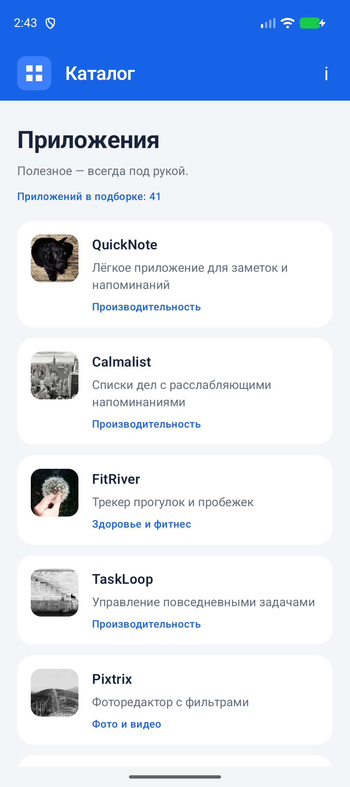
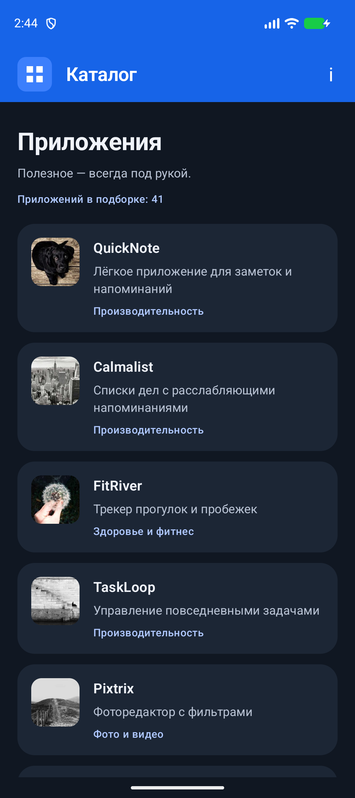

# Каталог приложений

[← К списку заданий](../../README.md)

Учебное приложение на Kotlin и Jetpack Compose. На главном экране — список приложений с иконками, описаниями и категориями. По нажатию открывается карточка с подробностями и витриной: девять приложений на трёх перелистываемых страницах.

Каталог постепенно дополняется по ходу курса. В заданиях 4–6 появились экраны, навигация, ViewModel и разделение на слои. В задании 7 добавлен Hilt для внедрения зависимостей.

## Как выглядит

 

Все данные и иконки хранятся в приложении, поэтому интернет для работы не нужен. Есть светлая и тёмная темы. Кнопка информации в тулбаре показывает snackbar, а положение списка сохраняется при пересоздании Activity.

## Задание 7: внедрение зависимостей

Раньше `MainActivity` сама создавала источник данных и репозиторий, а для ViewModel была отдельная фабрика. Теперь эти зависимости создаёт Hilt.

Основные изменения:

- Добавлен `AppCatalogApplication` с `@HiltAndroidApp`, а Activity отмечена `@AndroidEntryPoint`.
- В [AppModule.kt](src/main/java/com/example/vkcourse/applist/di/AppModule.kt) два метода `@Binds` связывают интерфейсы репозитория и источника данных с их реализациями. Метод `@Provides` создаёт `GetCatalogAppsUseCase`.
- [AppCatalogViewModel](src/main/java/com/example/vkcourse/applist/presentation/AppCatalogViewModel.kt) получает Use Case через конструктор с `@Inject`. Для создания ViewModel используется `hiltViewModel()`.

Например, связь интерфейса репозитория с реализацией описана так:

```kotlin
@Binds
@Singleton
abstract fun bindAppRepository(impl: AppRepositoryImpl): AppRepository
```

Когда Use Case запрашивает `AppRepository`, Hilt передаёт ему `AppRepositoryImpl`. Сам Use Case не содержит аннотаций Hilt: его создание описано в DI-модуле, поэтому слой domain остаётся независимым от фреймворка.

## Как устроен код

Исходники находятся в `src/main/java/com/example/vkcourse/applist/`:

- `data` — список приложений, DTO, преобразование данных и реализация репозитория.
- `domain` — модели, интерфейс репозитория и Use Case для получения каталога.
- `presentation` — Compose-экраны, навигация и ViewModel. Состояние экрана хранится в `StateFlow`, события snackbar передаются через `Channel`.
- `di` — модуль Hilt, в котором описано создание зависимостей.

ViewModel обращается к Use Case, тот — к интерфейсу репозитория. Репозиторий получает данные из локального источника и преобразует DTO в модели каталога.

## Как запустить

1. Открыть корневую папку репозитория в Android Studio.
2. Установить Android SDK Platform 37 и выполнить Gradle Sync. Для сборки нужен полный JDK 25 — он указан в настройках проекта.
3. Выбрать модуль `homework-04` и запустить его на эмуляторе или устройстве с Android 7.0 и новее.

Собрать APK из PowerShell можно командой из корня репозитория:

```powershell
.\gradlew.bat :homework-04:assembleDebug
```

Готовый файл: `assignments/04-compose-app-list/build/outputs/apk/debug/homework-04-debug.apk`.

## Проверка

```powershell
# Сборка, unit-тесты и lint
.\gradlew.bat :homework-04:assembleDebug :homework-04:testDebugUnitTest :homework-04:lintDebug

# UI-тесты на запущенном эмуляторе или подключённом устройстве
.\gradlew.bat :homework-04:connectedDebugAndroidTest
```

После добавления Hilt прошли 4 unit-теста и 7 UI-тестов на Pixel 10 (API 37). Они проверяют преобразование данных, загрузку каталога, переходы между экранами, витрину, snackbar и пересоздание Activity. APK собирается; lint завершился без ошибок, с одним предупреждением `DataExtractionRules` о настройках резервного копирования.

Если сборка сообщает, что не найден `jlink`, нужно проверить JDK для Gradle: среда Java из расширения VS Code может не содержать этот инструмент. После выбора полного JDK можно повторить команду с `--no-daemon`.

Для ручной самопроверки: открыть каталог, перейти в карточку, перелистать витрину и вернуться назад. Затем прокрутить список, повернуть устройство и убедиться, что положение сохранилось.

## Ссылки для сдачи

- [Репозиторий](https://github.com/tsostanov/vk-course)
- [Решение задания 7 — Pull Request №6](https://github.com/tsostanov/vk-course/pull/6)
