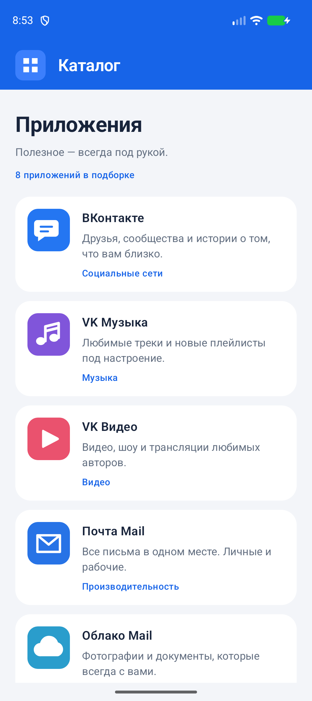
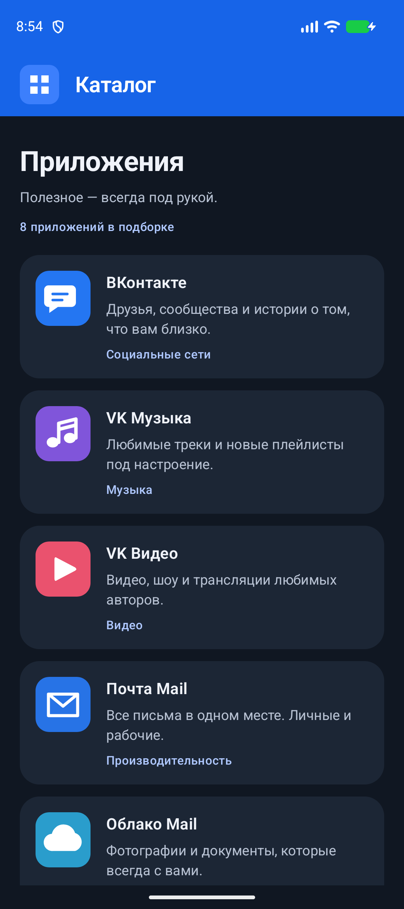

# Задание 4 · Создание UI в Android

[← Все задания курса](../../README.md)

Экран каталога приложений на Kotlin и Jetpack Compose. Сверху — синий тулбар с иконкой каталога; ниже — вертикальный список приложений. У каждого есть локальная иконка, название, короткое описание и категория. Нажатие на приложение открывает его карточку с описанием и витриной.

## Интерфейс

 

## Условия и реализация

| Требование | Реализация |
| --- | --- |
| Тулбар сверху, иконка текущего приложения слева | `TopAppBar` с той же иконкой, что используется для запуска каталога |
| Акцентный цвет тулбара | Синий фон и светлый заголовок |
| Вертикальный список | `LazyColumn` с постоянными ключами элементов |
| Иконка, название, описание, категория | `AppListItem` для каждого приложения |
| Вёрстка на Jetpack Compose | Весь экран в Compose, без XML-макетов |
| Захардкоженные данные | `sampleApps`, строки и векторные иконки в ресурсах; интернет не требуется |
| Карточка приложения | Экран подробностей оформлен по образцу практической части и использует данные каталога |
| Витрина | `HorizontalPager`: три страницы, по три приложения на странице |
| Навигация | Jetpack Compose Navigation связывает каталог и карточки приложений |

Поддержаны светлая и тёмная темы, системные отступы и увеличенный шрифт. Высота строк зависит от текста, положение списка сохраняется при пересоздании Activity. В Android Studio доступны три Preview: светлый, тёмный и с крупным шрифтом.

Внизу карточки находится витрина из девяти приложений. Она разбита на три горизонтально перелистываемые страницы, по три карточки на каждой. Карточки используют тот же `AppListItem`, что и каталог. Нажатие на карточку витрины возвращает в список приложений. Иконки — учебные векторные иллюстрации.

## Запуск

Открыть корень репозитория в Android Studio, выполнить Gradle Sync и выбрать модуль **`homework-04`**. Общие требования к SDK и JDK — в [README курса](../../README.md#запуск-в-android-studio).

Из корня репозитория в PowerShell:

```powershell
.\gradlew.bat :homework-04:assembleDebug
& "$env:LOCALAPPDATA/Android/Sdk/platform-tools/adb.exe" install -r assignments/04-compose-app-list/build/outputs/apk/debug/homework-04-debug.apk
& "$env:LOCALAPPDATA/Android/Sdk/platform-tools/adb.exe" shell am start -n com.example.vkcourse.applist/.MainActivity
```

## Где что находится

```text
src/main/java/com/example/vkcourse/applist/
├── MainActivity.kt          # Точка входа
├── data/CatalogApp.kt       # Модель и готовый набор данных
└── ui/
    ├── AppCatalogScreen.kt # Каталог и переиспользуемая карточка списка
    ├── AppDetailsScreen.kt # Карточка приложения и Pager-витрина
    ├── AppNavigation.kt    # Переходы между каталогом и карточками
    └── Theme.kt            # Цвета светлой и тёмной тем
src/main/res/
├── drawable/               # Локальные векторные иконки
└── values/strings.xml      # Названия, описания и категории
```

В [примере преподавателя](https://github.com/maltsevmicyou/VkEducation) модель приложения содержит также данные для экрана подробностей и работы с сетью. Здесь оставлены поля, нужные для задания 4: `id`, название, описание, категория и иконка. Вместо URL используются локальные ресурсы.

## Самопроверка

- [ ] При запуске виден синий тулбар с иконкой каталога слева.
- [ ] У каждого приложения есть иконка, название, описание и категория.
- [ ] Список прокручивается до «VK Образование», тулбар остаётся сверху.
- [ ] Нажатие на приложение открывает карточку с описанием.
- [ ] Внизу карточки есть витрина из трёх страниц по три приложения.
- [ ] Страницы витрины перелистываются горизонтально.
- [ ] Нажатие на приложение в витрине возвращает в каталог.
- [ ] После поворота устройства или пересоздания Activity положение списка сохраняется.
- [ ] В тёмной теме текст и иконки читаются.
- [ ] При увеличении системного шрифта карточки растут по высоте, текст не обрезается.
- [ ] Без интернета отображаются все данные и иконки.

## Автоматические проверки

```powershell
.\gradlew.bat :homework-04:assembleDebug :homework-04:lintDebug
# На эмуляторе или устройстве:
.\gradlew.bat :homework-04:connectedDebugAndroidTest
```

UI-тесты проверяют обязательные поля карточки каталога, доступность последнего приложения при прокрутке, восстановление позиции после пересоздания Activity, открытие карточки и возврат в каталог из витрины.

Отчёты: `build/reports/lint-results-debug.html` и `build/reports/androidTests/connected/debug/index.html` внутри этой папки.

## Сдача

Пример экрана подробностей: [практический репозиторий VkEducation](https://github.com/maltsevmicyou/VkEducation). Для сдачи нужны ссылка на [репозиторий](https://github.com/tsostanov/vk-course) и Pull Request ветки решения в `main`.
